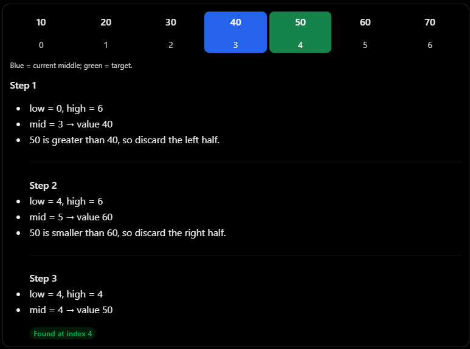

# Date 27 Nov 2026
# Session 5

## Topic - Binary Search in Java

### 1. Why do we need Binary search?
Linear Search checks elements one-by-one, Binary Search is faster on a sorted array because it eliminates half of the remaining search range at each step.
```
  Important condition
  - Array must be sorted
  - Binary search relies on the elements being in ascending or descending order.
```
### 2. Understand <code>low</code>, <code>high</code> and <code>mid</code>  
Binary search maintains three important variables:
  - <code>low</code>: first index in current search range.
  - <code>high</code>: last index in current search range.
  - <code>mid</code>: middle index of that range.

Calculate the middle index using:
```java
  int mid = low + (high - low) / 2
```  
Then compare <code>arr[mid]</code> with the target:
| Condition | Action |
|---|---|
| <code>arr[mid] == target | Target Found |
| <code>arr[mid] < target | Search the right half: low = mid + 1 |
| <code> arr[mid] > target | Search the left half: low = mid - 1

### 3. Worked Example - Find 50
Sorted Array :  
    
What if the Target isn't present?
Search for 25 in the same array:  
| Step | low | high | mid | Middle Value | Action |
|:---|---:|---:|---:|---:|:---|
| 1 | 0 | 6 | 3 | 40 | Move high to 2 |
| 2 | 0 | 2 | 1 | 20 | Move low to 2 |
| 3 | 2 | 2 | 2 | 30 | Move high to 1 |

Now <code>low = 2</code> and <code>high = 1</code>. Since <code>low > high</code>, the search stops and return <code>-1</code>.  

### 4. Java Implementation  
  [Binary Search](../BinarySearch.java)

### 5. Complexity analysis  
  | Case | Time Complexity | Explanation |
  |:---|:---|:---|
  | Best | O(1) | Middle Element is the target |
  | Average | O(log n) | Search range repeatedly halves |
  | Worst | O(log n) | Keeps halving until found or exhausted |

  Auxiliary space: O(1) because the iterative algorithm uses only <code>low</code>, <code>high</code> and <code>mid</code>.  
  For example, with 1,024 elements, binary search needs at most about 11 comparisons to narrow the search down to one element. This is why   it can be much faster than linear search on large sorted arrays.
  
### 6. 
