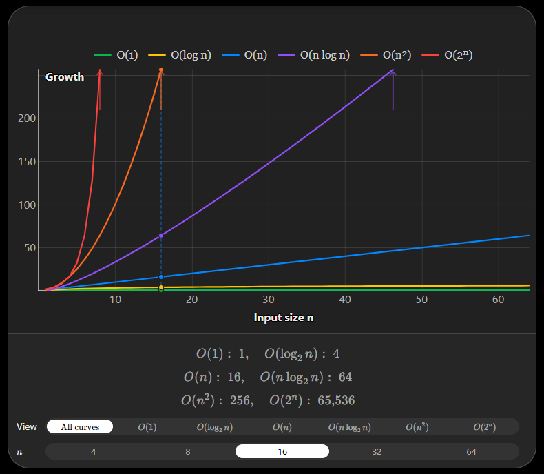

# Date 22 Nov 2026
# Session 2

## Topic - Big-O Complexity (Revise)
- Imagine you work at a company that stores student records.
  
  - 10 students: finding one student's record is easy.
  - 100 students: it takes more work.
  - 10,000 students: it may take much more work.

The important question isn't simply how long your code takes on your computer.

It is:  
  `When the amount of data increases, how does the amount of work increase?`  
That's what Big-O helps us understand.

  

### Your five-step complexity-solving method
This is the method I want you to use every time you analyse a program.
  1. Identify input size  
    `Find what n represents. Is it the number of array elements, students, transactions, or something else?`
  2. Identify the key operation  
    `What are you counting? A comparison, print, assignment, or database lookup?`
  3. Count executions  
   `Trace the loop. Does the operation execute once, n times, n × n times, or while the input is halved?`
  4. Simplify the growth  
   `Ignore constants and smaller terms. For example, 3n + 5 becomes n for Big-O analysis.`
  5. State time and extra space  
   `State how execution grows and whether the algorithm needs additional memory as input grows.`
