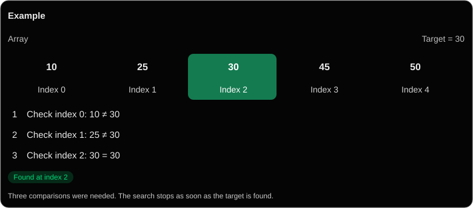

# Date 26 Nov 2026
# Session 4

## Topic - Linear Search in Java

### What is linear search?
Linear Search checks elements one-by-one, from left to right, until it find the target or reaches the end.

  

If the target is not present, the search checks every element and returns <code>-1</code>.

### Java Implementation  
[Click Here] (LinearSearch.java)  

### Complexity Analysis
| Case | What Happens | Time |
|---|---|---|
| Best | Target is the First Element | O(1) |
| Average | Several elements are checked | O(n) |
| Worst | Target is last or absent | O(n) |

**Auxiliary space: O(1)** - the iterative algorithm uses only a fixed number of extra variables, regardless of array length.
In software development, this is useful when searching an unsorted list, such as finding a student record or an order ID in a simple collection.
